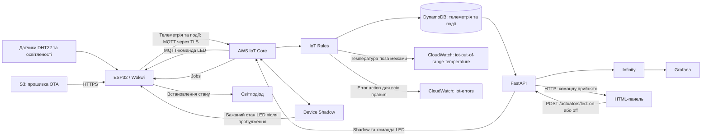

# ESP32 AWS Environment Monitor

IoT-система для моніторингу температури, вологості та освітленості з віддаленим керуванням LED і оновленням прошивки через AWS IoT Jobs. ESP32 працює циклами з Deep Sleep, а Device Shadow зберігає бажаний стан пристрою, поки він не в мережі.

## Можливості

- Збір показників DHT22 та датчика освітленості, передавання телеметрії через MQTT із TLS.
- Збереження вимірювань і подій кнопки / LED у DynamoDB.
- Записи в CloudWatch для температури нижче 15 °C або вище 28 °C; Error action для кожного IoT Rule.
- Керування LED з HTML-панелі через FastAPI, MQTT та Device Shadow.
- OTA із приватного S3-бакета: докачування після обриву, статуси Jobs і підтвердження нової прошивки після підключення до MQTT.
- Візуалізація в Grafana через Infinity та розгортання AWS-ресурсів через CloudFormation.

## Технології

| Частина | Стек |
|---|---|
| Пристрій | ESP32, C++ / Arduino, PlatformIO, PubSubClient, ArduinoJson |
| Симуляція | Wokwi, DHT22, аналоговий датчик освітленості, LED, кнопка |
| Хмара | AWS IoT Core, Device Shadow, Jobs, DynamoDB, S3, CloudWatch, IAM |
| Бекенд і керування | Python, FastAPI, boto3, HTML / JavaScript |
| Візуалізація та інфраструктура | Grafana, Infinity, CloudFormation |

## Архітектура

Телеметрія проходить через IoT Rules до DynamoDB, звідки її читає FastAPI. Grafana отримує дані лише від API. Команда LED змінює бажаний стан у Shadow і надсилається через MQTT; після пробудження ESP32 читає збережений стан і публікує `reported`.

## Технічні рішення

**Керування пристроєм під час сну.** Бекенд спочатку оновлює `desired.led`, потім публікує команду. Це дозволяє застосувати стан після наступного пробудження, навіть якщо пристрій пропустив MQTT-повідомлення.

**OTA з перевіркою запуску.** Прошивка запитує наступне завдання при підключенні. Завантаження підтримує HTTP Range для докачування; новий образ підтверджується після MQTT-підключення. Після перезапуску збіг версії з документом Job завершує завдання статусом `SUCCEEDED`.

**Історія даних.** У таблицях використано `device_id` та числовий `received_at`, який додається правилом AWS. Бекенд читає останній запис через Query та проходить сторінки історії через `LastEvaluatedKey`.

**Відтворювана інфраструктура.** Шаблон CloudFormation створює Thing, політики, правила, таблиці, групи логів, S3-бакет і IAM-ресурси. Розгортання перевірено в окремому AWS-акаунті.

## Запуск

Перевірене середовище: Windows, Wokwi, Python 3.14.6, Grafana 13.2.2; AWS — `eu-north-1`.

1. Розгорнути [шаблон CloudFormation](CloudFormation/cloudformation-template.json).
2. Створити сертифікат пристрою та ключ доступу бекенда; заповнити локальні `secrets.h` і `.env` за прикладами.
3. Зібрати ESP32 у PlatformIO та запустити Wokwi.
4. Запустити FastAPI, відкрити HTML-панель та імпортувати дашборд Grafana.

**[Покрокова інструкція запуску, налаштування Shadow та OTA](docs/setup.md)**

Секрети, локальні середовища та зібрані образи не включені до репозиторію. Сертифікат і ключі для свого акаунта потрібно створити окремо.

## Структура та документація

| Шлях | Вміст |
|---|---|
| [ESP32](ESP32) | Прошивка, схема Wokwi та налаштування PlatformIO |
| [FastAPI](FastAPI) | API телеметрії, подій і керування LED |
| [HTML](HTML) | Панель керування LED |
| [Grafana](Grafana) | Дашборд для імпорту |
| [CloudFormation](CloudFormation) | Шаблон розгортання AWS |
| [AWS](AWS/README.md) | Окремі конфігурації правил, ролей і політик |
| [Запуск](docs/setup.md) | Налаштування й відтворення проєкту |
| [Рішення та обмеження](docs/design.md) | Доставка повідомлень, пріоритет команд і межі реалізації |
| [Правила та політики](docs/aws.md) | SQL, дії правил і JSON політик |
| [Приклади роботи](docs/results.md) | MQTT, DynamoDB, Shadow, CloudWatch та OTA |

## Межі реалізації

Це навчальний прототип, перевірений у Wokwi та AWS. ESP32 публікує з QoS 0; короткі натискання кнопки під час сну можуть губитися. Перевірка часу та інтервалу сну потребує доопрацювання. OTA-клієнт використовує `setInsecure()`, а локальний HTTP API не має автентифікації. [Докладніше про поведінку та обмеження](docs/design.md).

## Походження проєкту

Проєкт розроблено під час навчання за матеріалами курсу IoT Developer. Приклади курсу стали основою MQTT/TLS, роботи з AWS, FastAPI, Grafana та OTA. Серед власних доопрацювань — докачування OTA після обриву, керування LED через Shadow для сплячого пристрою, події зміни LED, інтеграція компонентів і шаблон CloudFormation для відтворення інфраструктури.
