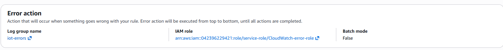
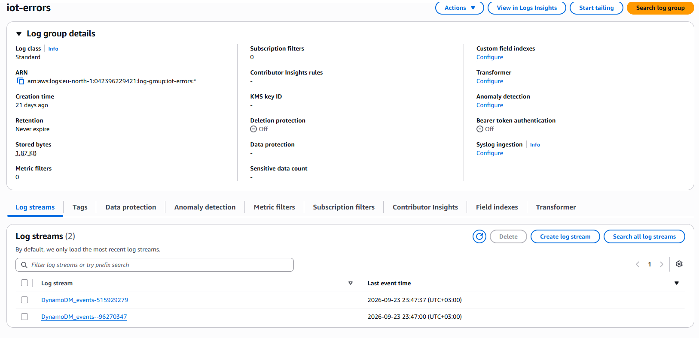

# Правила та політики AWS

Наведені нижче конфігурації вже створюються CloudFormation. JSON показано для `ESP32-Vlasenko`, префікса `iot-course/vlasenko` та регіону `eu-north-1`; `<ACCOUNT_ID>` і `<FIRMWARE_BUCKET>` позначають ваш акаунт і бакет. У шаблоні ці значення підставляються автоматично.

### IoT Rules

**`ddb_telemetry`**

```sql
SELECT *,

       timestamp() AS received_at,

       clientid()  AS client_id,

       topic(2)    AS student

FROM 'iot-course/vlasenko/telemetry'
```

Дія: DynamoDBv2 → `IoT_telemetry`. Error action: CloudWatch Logs → `iot-errors`, роль `CloudWatch-error-role`, Batch mode — `False`.

**`DynamoDB_events`**

```sql
SELECT *,

       timestamp() AS received_at,

       clientid()  AS client_id,

       topic(2)    AS student

FROM 'iot-course/vlasenko/events'
```

Дія: DynamoDBv2 → `IoT_Events`. Error action: CloudWatch Logs → `iot-errors`, роль `iot_cloudwatch_role`, Batch mode — `False`.

**`out_of_range_temperature`**

```sql
SELECT *, timestamp() AS received_at, clientid() AS client_id, topic(2) AS student FROM 'iot-course/vlasenko/telemetry' WHERE temperature > 28 OR temperature < 15
```

Дія: CloudWatch Logs → `iot-out-of-range-temperature`. Error action: CloudWatch Logs → `iot-errors`, роль `CloudWatch-error-role`, Batch mode — `False`.

Для всіх трьох правил налаштовано Error action: якщо виконання основної дії завершується помилкою, повідомлення про неї надходить у `iot-errors`.





### IoT Policies

<details>
<summary>ESP32-telemetry-and-comands</summary>

```json
{
  "Version": "2012-10-17",
  "Statement": [
    {
      "Resource": "arn:aws:iot:eu-north-1:<ACCOUNT_ID>:topic/iot-course/vlasenko/telemetry",
      "Action": "iot:Publish",
      "Effect": "Allow"
    },
    {
      "Resource": "arn:aws:iot:eu-north-1:<ACCOUNT_ID>:topic/iot-course/vlasenko/events",
      "Action": "iot:Publish",
      "Effect": "Allow"
    },
    {
      "Resource": "arn:aws:iot:eu-north-1:<ACCOUNT_ID>:client/ESP32-Vlasenko",
      "Action": "iot:Connect",
      "Effect": "Allow"
    },
    {
      "Resource": "arn:aws:iot:eu-north-1:<ACCOUNT_ID>:topicfilter/iot-course/vlasenko/commands/led",
      "Action": "iot:Subscribe",
      "Effect": "Allow"
    },
    {
      "Resource": "arn:aws:iot:eu-north-1:<ACCOUNT_ID>:topic/iot-course/vlasenko/commands/led",
      "Action": "iot:Receive",
      "Effect": "Allow"
    }
  ]
}
```

</details>

<details>
<summary>ESP32-Shadow</summary>

```json
{
  "Version": "2012-10-17",
  "Statement": [
    {
      "Resource": "arn:aws:iot:eu-north-1:<ACCOUNT_ID>:topic/$aws/things/ESP32-Vlasenko/shadow/get",
      "Action": "iot:Publish",
      "Effect": "Allow"
    },
    {
      "Resource": "arn:aws:iot:eu-north-1:<ACCOUNT_ID>:topic/$aws/things/ESP32-Vlasenko/shadow/update",
      "Action": "iot:Publish",
      "Effect": "Allow"
    },
    {
      "Resource": "arn:aws:iot:eu-north-1:<ACCOUNT_ID>:topicfilter/$aws/things/ESP32-Vlasenko/shadow/get/accepted",
      "Action": "iot:Subscribe",
      "Effect": "Allow"
    },
    {
      "Resource": "arn:aws:iot:eu-north-1:<ACCOUNT_ID>:topic/$aws/things/ESP32-Vlasenko/shadow/get/accepted",
      "Action": "iot:Receive",
      "Effect": "Allow"
    },
    {
      "Resource": "arn:aws:iot:eu-north-1:<ACCOUNT_ID>:topicfilter/$aws/things/ESP32-Vlasenko/shadow/update/delta",
      "Action": "iot:Subscribe",
      "Effect": "Allow"
    },
    {
      "Resource": "arn:aws:iot:eu-north-1:<ACCOUNT_ID>:topic/$aws/things/ESP32-Vlasenko/shadow/update/delta",
      "Action": "iot:Receive",
      "Effect": "Allow"
    },
    {
      "Resource": "arn:aws:iot:eu-north-1:<ACCOUNT_ID>:topicfilter/$aws/things/ESP32-Vlasenko/shadow/update/accepted",
      "Action": "iot:Subscribe",
      "Effect": "Allow"
    },
    {
      "Resource": "arn:aws:iot:eu-north-1:<ACCOUNT_ID>:topic/$aws/things/ESP32-Vlasenko/shadow/update/accepted",
      "Action": "iot:Receive",
      "Effect": "Allow"
    },
    {
      "Resource": "arn:aws:iot:eu-north-1:<ACCOUNT_ID>:topicfilter/$aws/things/ESP32-Vlasenko/shadow/update/rejected",
      "Action": "iot:Subscribe",
      "Effect": "Allow"
    },
    {
      "Resource": "arn:aws:iot:eu-north-1:<ACCOUNT_ID>:topic/$aws/things/ESP32-Vlasenko/shadow/update/rejected",
      "Action": "iot:Receive",
      "Effect": "Allow"
    },
    {
      "Resource": "arn:aws:iot:eu-north-1:<ACCOUNT_ID>:topicfilter/$aws/things/ESP32-Vlasenko/shadow/get/rejected",
      "Action": "iot:Subscribe",
      "Effect": "Allow"
    },
    {
      "Resource": "arn:aws:iot:eu-north-1:<ACCOUNT_ID>:topic/$aws/things/ESP32-Vlasenko/shadow/get/rejected",
      "Action": "iot:Receive",
      "Effect": "Allow"
    }
  ]
}
```

</details>

<details>
<summary>ESP32-Jobs</summary>

```json
{
  "Version": "2012-10-17",
  "Statement": [
    {
      "Resource": "arn:aws:iot:eu-north-1:<ACCOUNT_ID>:topicfilter/$aws/things/ESP32-Vlasenko/jobs/notify-next",
      "Action": "iot:Subscribe",
      "Effect": "Allow"
    },
    {
      "Resource": "arn:aws:iot:eu-north-1:<ACCOUNT_ID>:topicfilter/$aws/things/ESP32-Vlasenko/jobs/$next/get/accepted",
      "Action": "iot:Subscribe",
      "Effect": "Allow"
    },
    {
      "Resource": "arn:aws:iot:eu-north-1:<ACCOUNT_ID>:topic/$aws/things/ESP32-Vlasenko/jobs/notify-next",
      "Action": "iot:Receive",
      "Effect": "Allow"
    },
    {
      "Resource": "arn:aws:iot:eu-north-1:<ACCOUNT_ID>:topic/$aws/things/ESP32-Vlasenko/jobs/$next/get/accepted",
      "Action": "iot:Receive",
      "Effect": "Allow"
    },
    {
      "Resource": "arn:aws:iot:eu-north-1:<ACCOUNT_ID>:topic/$aws/things/ESP32-Vlasenko/jobs/$next/get",
      "Action": "iot:Publish",
      "Effect": "Allow"
    },
    {
      "Resource": "arn:aws:iot:eu-north-1:<ACCOUNT_ID>:topic/$aws/things/ESP32-Vlasenko/jobs/*/update",
      "Action": "iot:Publish",
      "Effect": "Allow"
    }
  ]
}
```

</details>

### IAM-політики

Політика `ESP32-Vlasenko-backend-policy` дозволяє читати дві таблиці, публікувати команду LED та змінювати Shadow одного Thing. Решта політик забезпечують запис із правил у DynamoDB / CloudWatch та читання образу OTA із S3.

<details>
<summary>ESP32-Vlasenko-backend-policy</summary>

```json
{
  "Version": "2012-10-17",
  "Statement": [
    {
      "Resource": [
        "arn:aws:iot:eu-north-1:<ACCOUNT_ID>:topic/iot-course/vlasenko/commands/led",
        "arn:aws:dynamodb:eu-north-1:<ACCOUNT_ID>:table/IoT_telemetry",
        "arn:aws:dynamodb:eu-north-1:<ACCOUNT_ID>:table/IoT_Events"
      ],
      "Action": [
        "dynamodb:Query",
        "iot:Publish"
      ],
      "Effect": "Allow",
      "Sid": "VisualEditor0"
    },
    {
      "Resource": "arn:aws:iot:eu-north-1:<ACCOUNT_ID>:thing/ESP32-Vlasenko",
      "Action": "iot:UpdateThingShadow",
      "Effect": "Allow",
      "Sid": "VisualEditor1"
    }
  ]
}
```

</details>

<details>
<summary>aws-iot-rule-ddb_telemetry-action-1-role-dbb_telemetry</summary>

```json
{
  "Version": "2012-10-17",
  "Statement": {
    "Resource": "arn:aws:dynamodb:eu-north-1:<ACCOUNT_ID>:table/IoT_telemetry",
    "Action": "dynamodb:PutItem",
    "Effect": "Allow"
  }
}
```

</details>

<details>
<summary>aws-iot-rule-DynamoDM_events-erroraction-role-CloudWatch-error-role</summary>

```json
{
  "Version": "2012-10-17",
  "Statement": [
    {
      "Resource": [
        "arn:aws:logs:eu-north-1:<ACCOUNT_ID>:log-group:iot-errors:*"
      ],
      "Action": [
        "logs:CreateLogStream",
        "logs:DescribeLogStreams",
        "logs:PutLogEvents"
      ],
      "Effect": "Allow"
    }
  ]
}
```

</details>

<details>
<summary>aws-iot-rule-out_of_range_temperature-erroraction-role-CloudWatch-error-role</summary>

```json
{
  "Version": "2012-10-17",
  "Statement": [
    {
      "Resource": [
        "arn:aws:logs:eu-north-1:<ACCOUNT_ID>:log-group:iot-errors:*"
      ],
      "Action": [
        "logs:CreateLogStream",
        "logs:DescribeLogStreams",
        "logs:PutLogEvents"
      ],
      "Effect": "Allow"
    }
  ]
}
```

</details>

<details>
<summary>aws-iot-rule-out_of_range_temperature-action-1-role-iot_cloudwatch_role</summary>

```json
{
  "Version": "2012-10-17",
  "Statement": [
    {
      "Resource": [
        "arn:aws:logs:eu-north-1:<ACCOUNT_ID>:log-group:iot-out-of-range-temperature:*"
      ],
      "Action": [
        "logs:CreateLogStream",
        "logs:DescribeLogStreams",
        "logs:PutLogEvents"
      ],
      "Effect": "Allow"
    }
  ]
}
```

</details>

<details>
<summary>aws-iot-rule-DynamoDB_events-action-1-role-iot-dynamodb-events-role</summary>

```json
{
  "Version": "2012-10-17",
  "Statement": {
    "Resource": "arn:aws:dynamodb:eu-north-1:<ACCOUNT_ID>:table/IoT_Events",
    "Action": "dynamodb:PutItem",
    "Effect": "Allow"
  }
}
```

</details>

<details>
<summary>aws-iot-rule-DynamoDB_events-erroraction-role-iot_cloudwatch_role</summary>

```json
{
  "Version": "2012-10-17",
  "Statement": [
    {
      "Resource": [
        "arn:aws:logs:eu-north-1:<ACCOUNT_ID>:log-group:iot-errors:*"
      ],
      "Action": [
        "logs:CreateLogStream",
        "logs:DescribeLogStreams",
        "logs:PutLogEvents"
      ],
      "Effect": "Allow"
    }
  ]
}
```

</details>

<details>
<summary>aws-iot-rule-ddb_telemetry-erroraction-role-CloudWatch-error-role</summary>

```json
{
  "Version": "2012-10-17",
  "Statement": [
    {
      "Resource": [
        "arn:aws:logs:eu-north-1:<ACCOUNT_ID>:log-group:iot-errors:*"
      ],
      "Action": [
        "logs:CreateLogStream",
        "logs:DescribeLogStreams",
        "logs:PutLogEvents"
      ],
      "Effect": "Allow"
    }
  ]
}
```

</details>

<details>
<summary>aws-iot-role-s3GetObjectVersion_1790850083401</summary>

```json
{
  "Version": "2012-10-17",
  "Statement": [
    {
      "Condition": {
        "StringEquals": {
          "s3:ResourceAccount": "<ACCOUNT_ID>"
        }
      },
      "Resource": [
        "arn:aws:s3:::<FIRMWARE_BUCKET>/*"
      ],
      "Action": [
        "s3:GetObject",
        "s3:GetObjectVersion"
      ],
      "Effect": "Allow",
      "Sid": "S3GetObjects"
    }
  ]
}
```

</details>
