# Приклади роботи системи

### Пристрій, сертифікат і політики

До Thing `ESP32-Vlasenko` прикріплено сертифікат зі статусом `Active`.

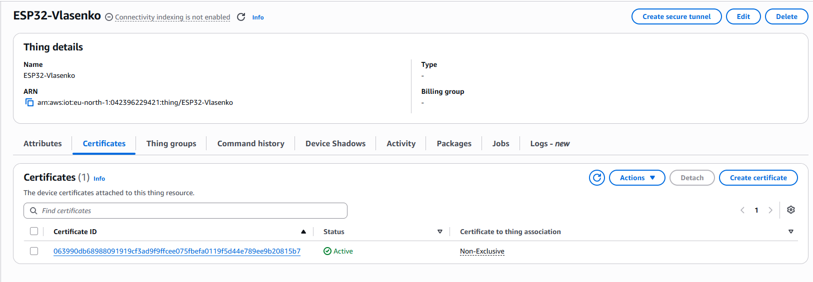

До цього сертифіката прикріплено політики `ESP32-telemetry-and-comands`, `ESP32-Shadow` та `ESP32-Jobs`.

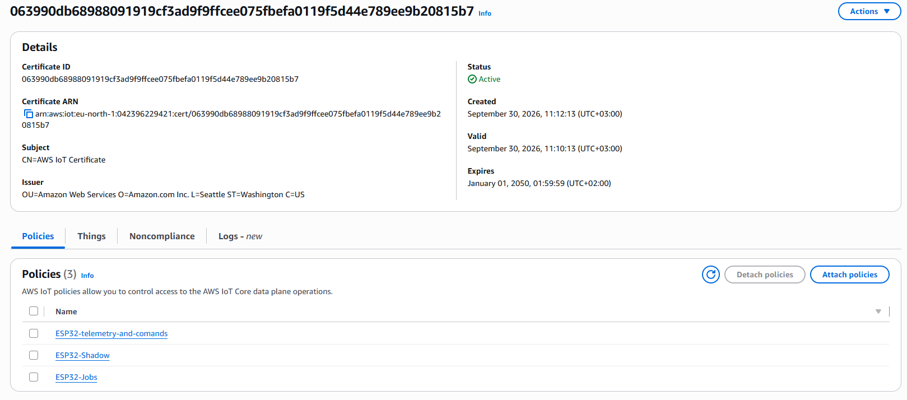

### Телеметрія MQTT

Пристрій надсилає у топік `iot-course/vlasenko/telemetry` вісім полів: `device_id`, `timestamp`, `temperature`, `humidity`, `light_level`, `firmware_version`, `uptime_sec`, `free_heap`. На скриншоті видно отримані повідомлення з ненульовим Unix timestamp і версією прошивки `1.0.0`.

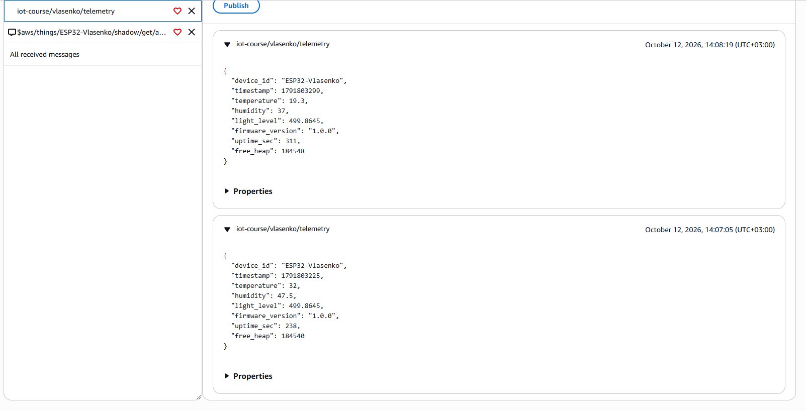

### Події MQTT

У топік `iot-course/vlasenko/events` надходять події натискання кнопки — `manual_trigger` зі значенням `pressed`, та керування світлодіодом — `led_changed` зі значенням `on` або `off`.

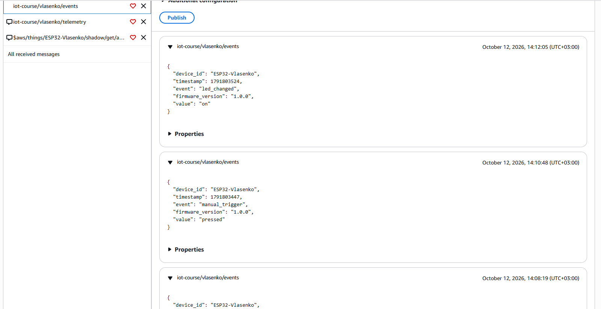

### Телеметрія в DynamoDB

Таблиця `IoT_telemetry` використовує partition key `device_id` (String) та sort key `received_at` (Number). Режим оплати — On-demand.

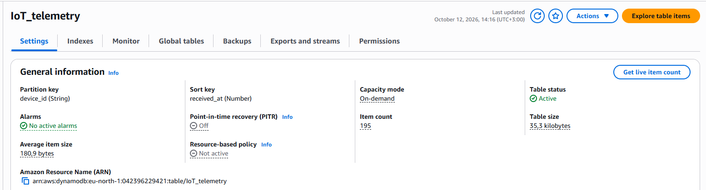

Збережені вимірювання пристрою, зокрема температура, вологість, освітленість і версія прошивки:

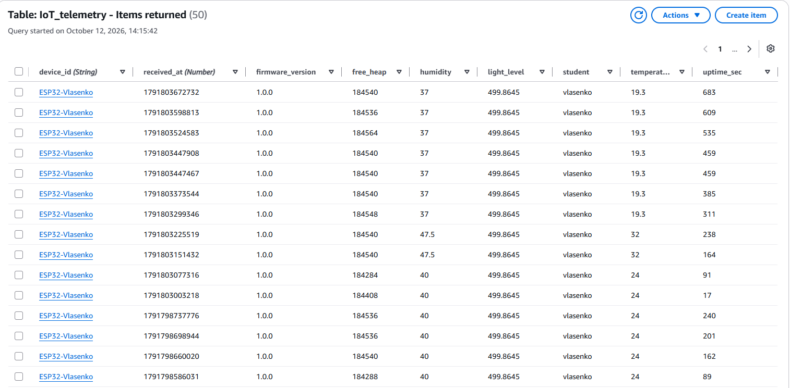

### Події в DynamoDB

Таблиця `IoT_Events` зберігає події кнопки та керування LED разом зі значенням `value`, часом і версією прошивки.

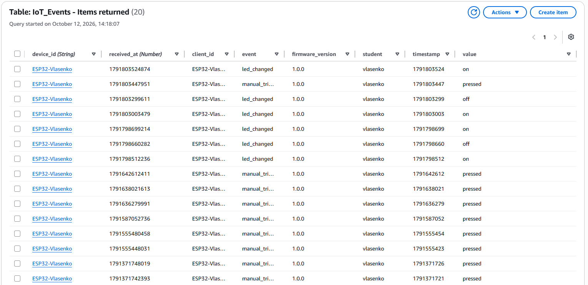

### Температурні сповіщення в CloudWatch

Правило `out_of_range_temperature` записує повідомлення в CloudWatch Logs, якщо температура нижча за 15 °C або вища за 28 °C. На скриншотах — записи для 14 °C та 32 °C. [Список потоків логів](../screenshots/cloudwatch-streams.png).

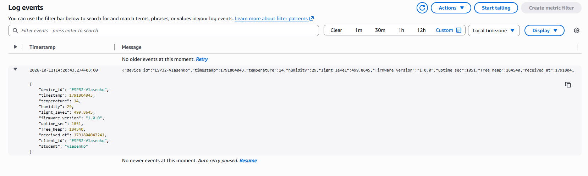

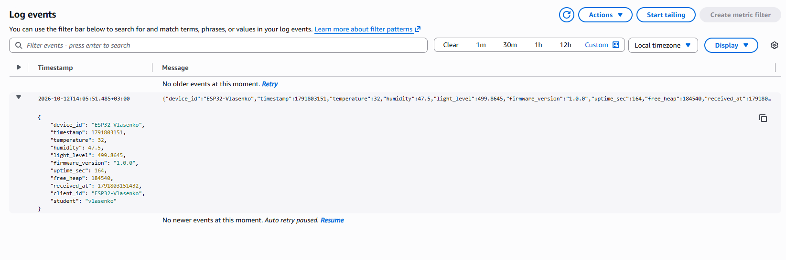

### Синхронізація Device Shadow

Бажаний і фактичний стани збігаються: `led: on`, `sleep_interval_sec: 60`. У `reported` також зазначена версія прошивки `1.0.0` — стан до OTA-оновлення.

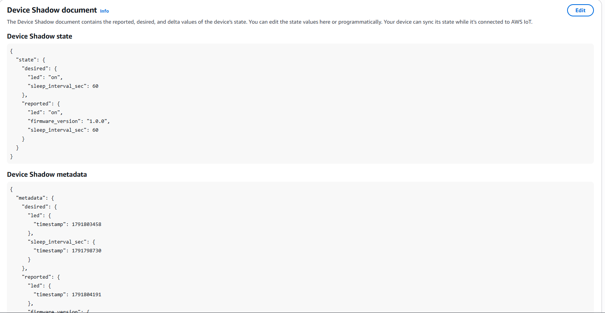

### Файли OTA в S3

Бакет `esp32-ota-vlasenko` містить образ прошивки `firmware.bin` і документ завдання `job.json`. Для OTA використовується саме `firmware.bin`, а не `merged.bin`.

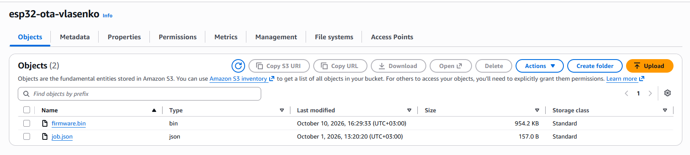

### Завдання OTA

Документ завдання `OTA_1210` задає операцію `ota`, версію `1.1.0` та посилання на `firmware.bin` із підстановкою підписаного URL AWS IoT.

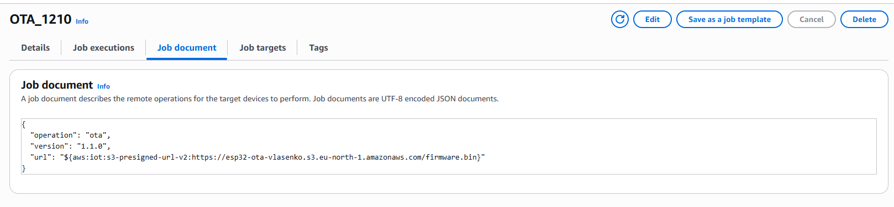

Виконання для `ESP32-Vlasenko` має статус `Succeeded`. [Деталі завершеного завдання](../screenshots/ota-job-details.png).

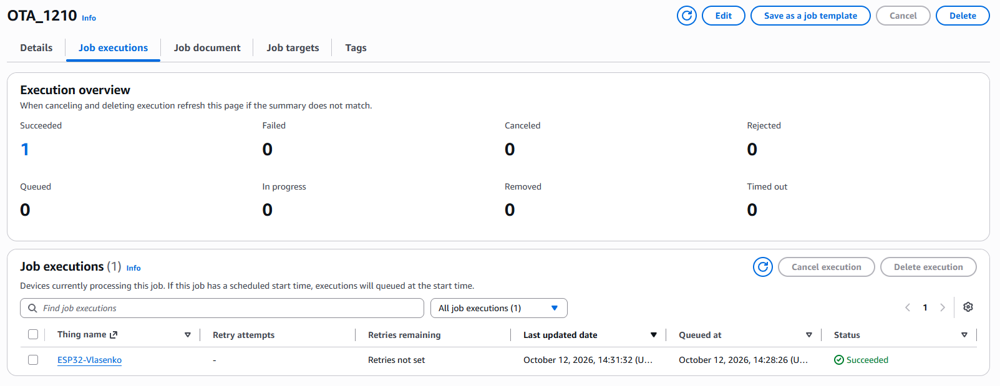

У терміналі видно завантаження образу, перезапуск і підтвердження нової прошивки. У DynamoDB після записів із версією `1.0.0` надходять вимірювання з `1.1.0`.

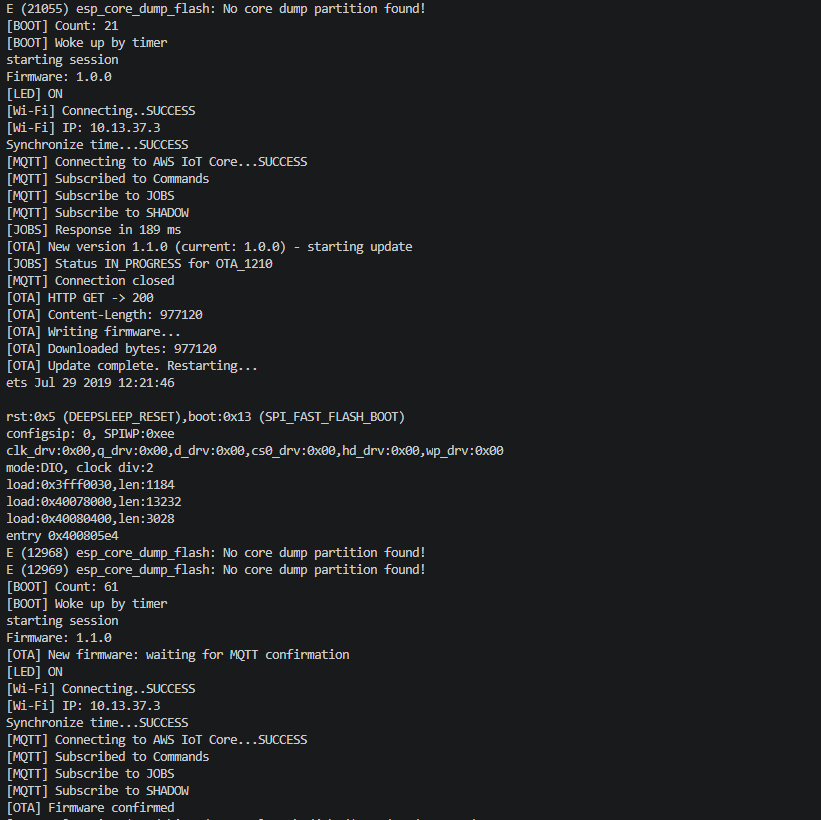

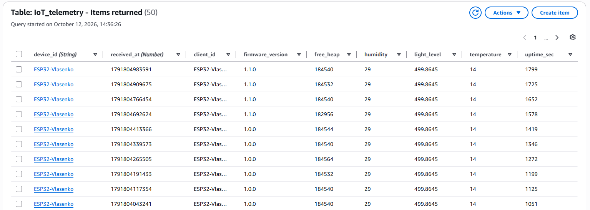

Shadow також підтверджує версію `1.1.0`; значення LED та інтервалу сну синхронізовані.

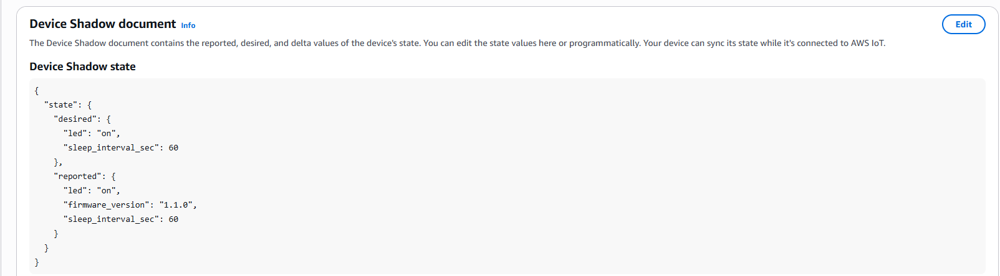

### Дашборд Grafana

Графік температури й вологості, освітленість, uptime, час останнього отримання даних та таблиця подій зі значеннями `pressed`, `on`, `off`.

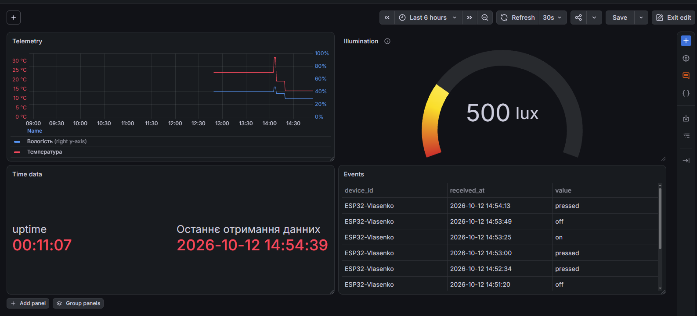
